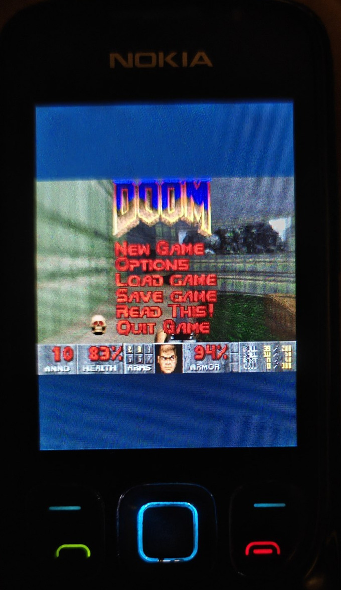
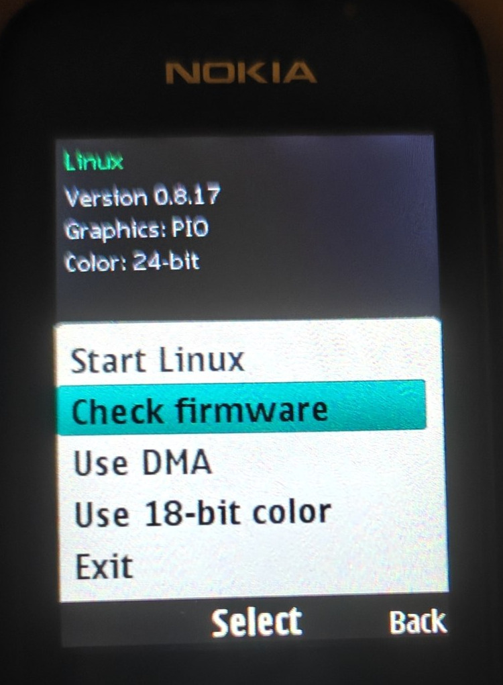
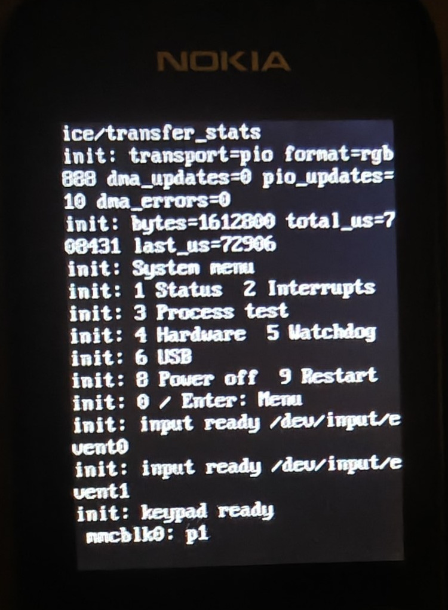
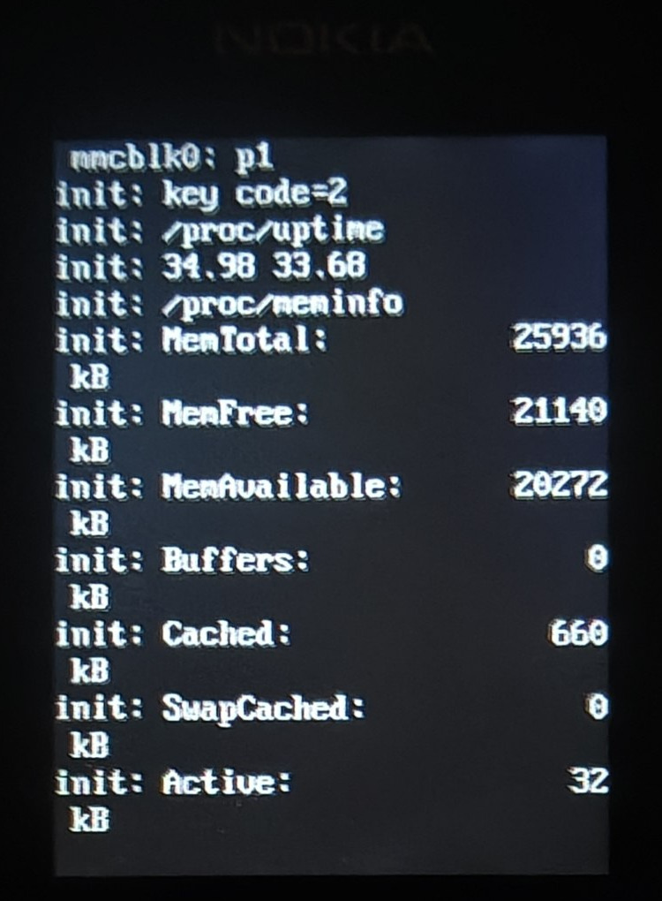

# Homebrew on [Nokia Series 40](https://en.wikipedia.org/wiki/Series_40)

Nokia had sold 1.5 billion S40 phones by 2012, yet the platform remained pretty much a dead end for native homebrew. Unlike Symbian S60, it had no official way to install native applications. Even other "dumb phone" platforms from Sony Ericsson and Siemens had native homebrew communities. S40 never did.

This research project brings native homebrew to S40. Run a `.jar` file and it executes ARM/Thumb code on the bare hardware - from there, native applications can call firmware services directly for graphics, input, files, and more. It works by exploiting an integer-overflow bug in S40's `Image.getRGB` implementation that spans S40 2nd–6th Edition (first-generation S40 lacks `Image.getRGB`).

## Compatibility

S40 phones use different CPUs and firmware interfaces. See the [homebrew guide](homebrew/README.md) for applications and supported models.

## How it works

### 1. Overflow the Java bounds checks

The J2ME method `Image.getRGB` copies pixels from an image into an integer array. It is required [by the specification](https://docs.oracle.com/javame/config/cldc/ref-impl/midp2.0/jsr118/javax/microedition/lcdui/Image.html) to check the bounds and throw an exception if the copy would exceed them.

Take a 1×1 image containing the pixel value `0x40000000` and an `int[8]` destination array. Pass these arguments to `getRGB`:

```java
image.getRGB(
    /* rgbData    */ destination,
    /* offset     */ 0x4000000B,
    /* scanlength */ 0x40000001,
    /* x          */ 0x40000000,
    /* y          */ 0,
    /* width      */ 0x40000001,
    /* height     */ 1
);
```

The checks use signed 32-bit arithmetic, so both upper-bound calculations wrap:

- **Image bounds:** `x + width` becomes `0x80000001` (`-2147483647`), which isn't greater than the image width of `1`.
- **Array bounds:** with `height = 1`, the check reduces to `offset + width`. That becomes `0x8000000C` (`-2147483636`), which isn't greater than the array length of `8`.

The other checks pass too: all arguments are nonnegative, `scanlength == width`, `y + height == 1`, and the last-row offset stays at the positive value `0x4000000B`. The copy is allowed through.

<details>
<summary>Java implementation from the S40v6 SDK</summary>

Taken from the [decompiled S40v6 SDK classes](https://github.com/0x726564/S40-SDK-Classes/blob/decec09b9479214ce790ed3ad2e9e07ef084bdc6/S40v6/src/javax/microedition/lcdui/Image.java#L80-L95):

```java
public void getRGB(int[] rgbData, int offset, int scanlength,
                   int x, int y, int width, int height) {
    if (rgbData == null) {
        throw new NullPointerException();
    } else if (x < 0 || y < 0
            || x + width > this.pixmap.getWidth()
            || y + height > this.pixmap.getHeight()
            || scanlength >= 0 && scanlength < width
            || scanlength < 0 && 0 - scanlength < width) {
        throw new IllegalArgumentException();
    } else {
        if (width >= 0 && height >= 0) {
            if (offset < 0
                    || offset + width + (height - 1) * scanlength > rgbData.length
                    || offset + (height - 1) * scanlength < 0) {
                throw new ArrayIndexOutOfBoundsException();
            }
            this.pixmap.nativeGetRGBFromPixmap(
                    rgbData, offset, scanlength, x, y, width, height);
        }
    }
}
```

</details>

### 2. Turn the pixel copy into an out-of-bounds write

The same arguments now reach the native Pixmap implementation, which keeps only the low 16 bits of the coordinates, dimensions, and scan length. `x` becomes `0`; `width` and `scanlength` become `1`. With `y = 0` and `height = 1` unchanged, the huge request becomes a one-pixel copy from `(0, 0)`.

The destination offset stays 32-bit. Multiplying `0x4000000B` by four wraps to `0x2C`: 44 bytes, or 11 integer slots. The native code never checks the array's actual length, so it writes the pixel to `destination[11]`, even though the array has only eight elements.

<details>
<summary>Native pseudocode from the Nokia 6303 classic</summary>

Abridged Hex-Rays output from firmware 08.90, address `0xF0CA6FDE`. Names are cleaned up; unrelated setup and cleanup are omitted.

```c
int offset     = KNI_GetParameterAsInt(2);
int scanlength = KNI_GetParameterAsInt(3);
int x          = KNI_GetParameterAsInt(4);
int y          = KNI_GetParameterAsInt(5);
int width      = KNI_GetParameterAsInt(6);
int height     = KNI_GetParameterAsInt(7);

// ...
KNI_GetParameterAsObject(1, &rgbDataObject);

// The array data starts 12 bytes after its object header begins.
// This is wrapping 32-bit address arithmetic, with no array-length check.
dst.pixels = (uint32_t *)(rgbDataObject + 12u + ((uint32_t)offset << 2));
dst.width  = (uint16_t)scanlength;  // destination row stride in pixels
dst.height = (uint16_t)height;
dst.format = 12;                   // 32-bit ARGB

gdi_copy_area(&src, &dst, params,
              (int16_t)x, (int16_t)y,
              (uint16_t)width, (uint16_t)height, 0, 0);
// ...
```

</details>

### 3. Turn one write into arbitrary memory access

With the right Java heap layout, `destination[11]` lands on a nearby array's length field. Our pixel value, `0x40000000`, replaces its original length of `1`. The VM now thinks the array is enormous. Normal, high-level Java array indexing gives us arbitrary aligned reads and writes in the VM's mapped address space.

### 4. Enter native code

From there, the chain follows live object pointers to the KVM's class and method records, finds a suitable native method entry, and temporarily redirects it to a Thumb payload. Calling that method from Java enters the native code. Cache synchronization and finding executable memory are device- and firmware-specific.

### 5. Make it usable

For a reliable chain, you need to do all this without corrupting the OS or Java VM, restore the temporary changes, and load the native application.

The application can then call firmware services directly for memory, files, graphics, and input. You can even take over the running OS and boot Linux.

## FAQ

### Can it run Doom?

Yes, through DoomGeneric. [Source and build guide](https://github.com/s40homebrew/doom).

<p>
  <a href="docs/images/doom.jpg"></a>
</p>

### Quake?

Yes, through TyrQuake, including sound. [Source and build guide](https://github.com/s40homebrew/tyrquake).

### Linux?

Yes, barebones Linux on the Nokia 6303 classic, taking over from the running S40 OS without flashing the firmware. Reboot to return to S40. [Source and build guide](https://github.com/s40homebrew/linux/tree/s40-linux/s40).

<p>
  <a href="docs/images/linux-launcher.jpg"></a>
  <a href="docs/images/linux-console.jpg"></a>
  <a href="docs/images/linux-memory.jpg"></a>
</p>

### What else?

[RAM Booster](homebrew/apps/ram_booster/README.md) increases Java app memory, and [PC Bridge](homebrew/apps/pc_bridge/README.md) provides native debugging over PC Suite. See the [homebrew guide](homebrew/README.md) for the other apps and examples.

### Where is the SDK?

The [shared SDK](homebrew/README.md) is in `homebrew/`. Start with the [build guide](docs/building.md) for setup and checkout commands.

## Why?

I was checking out old phone firmware with agents out of boredom, initially S60. Then someone pointed out that S60 was already substantially researched and suggested I try S40 instead. That's how this all started.

## How to contribute

Do more research, port the chain to more phones, work on the shared SDK, or create and port more apps.

## References and inspirations

- [S40 SDK classes](https://github.com/0x726564/S40-SDK-Classes)
- [CLDC / KVM source](https://github.com/sword865/j2me_cldc)
- [Sony Ericsson ElfPack and ELF applications](https://github.com/Rescor/SE_ELFS)
- [Siemens ELFLoader](https://github.com/siemens-mobile-hacks/elfloader3) and [SDK / SWILIB](https://github.com/siemens-mobile-hacks/sdk) - the loader and firmware interfaces behind Siemens native homebrew.

## LLM disclosure

The exploit, original project code, and other original files in this repo were written by LLMs. This README is 40/60 human and AI writing.

### Advice on using LLM agents

In my experience, frontier LLMs often refuse to help port this chain to another device, even when the goal is homebrew. Open-weight models such as DeepSeek V4.1 Flash or Kimi K3.1 Pro are another option; OpenAI also offers a cyber-verification route.

Once you have a full chain working on your device, you can usually use frontier LLMs for native app development, porting, and firmware reverse engineering without issues.

## Credits

Multiple people on Telegram and Discord helped me test the results on real hardware before I had phones of my own to test with. You know who you are :)

### LLM credits

- GPT-5.6 Sol (Daybreak): Discovered the vulnerability and created the first working payload, tested in a Nokia 6303 classic emulator.
- GPT-6 Astra: The Nokia 6303 classic emulator, extensive firmware reverse engineering, porting the chain to other S40 devices, game and kernel ports, and almost all of the original code currently in the repo.
- Kimi K3.1 Pro: Minor help with the exploit chain.

## License

Original project code and docs are [MIT licensed](LICENSE). Doom, TyrQuake, Linux and other third-party components keep their own licenses and notices. See [third-party notices](THIRD_PARTY.md).
